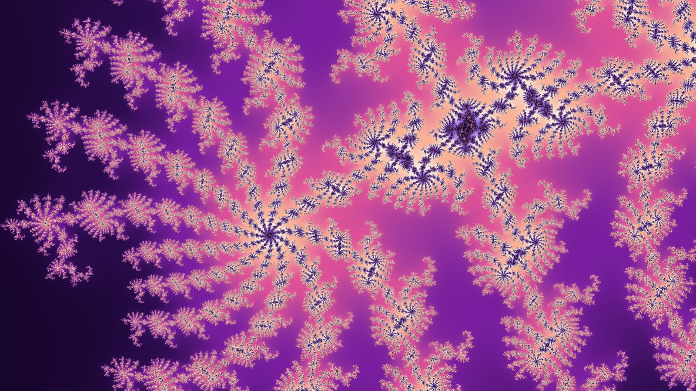
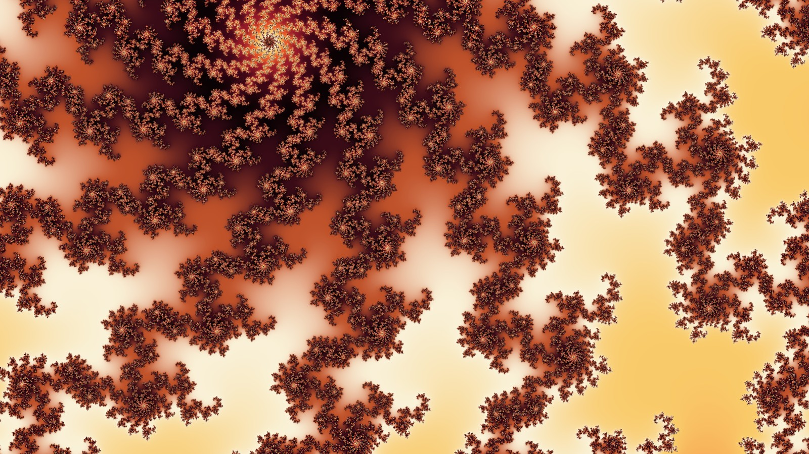
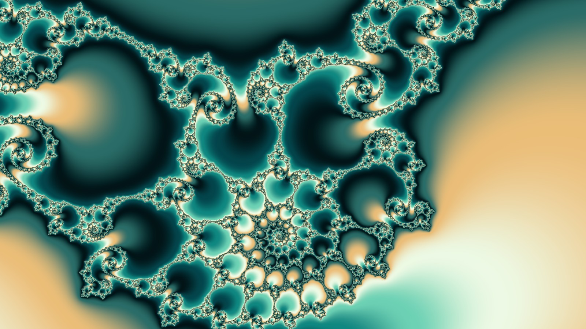
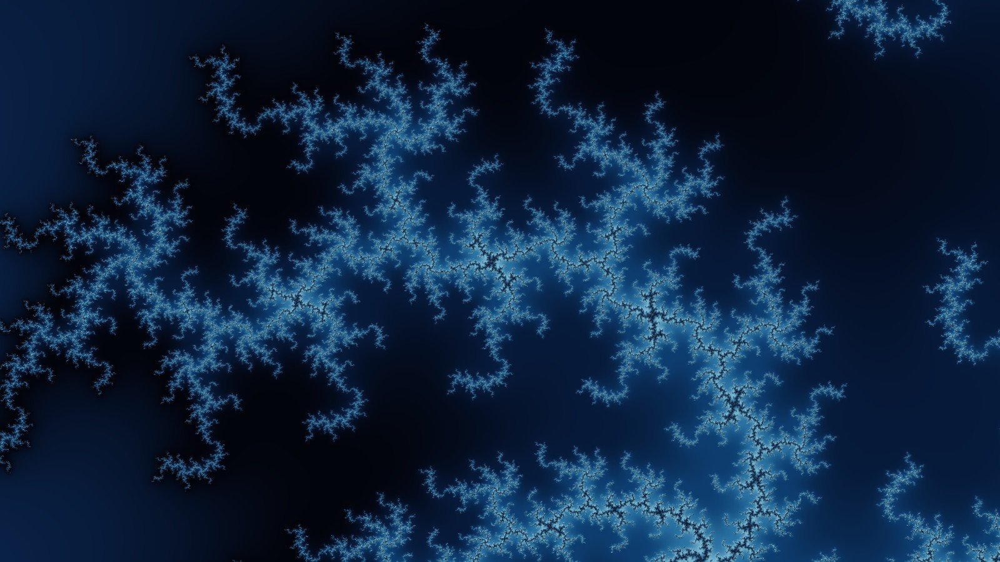

# Frax

**An infinite fractal explorer for the browser.** Press play and fall into the Mandelbrot set — forever.

[**▶ Open Frax**](https://swiftredvox.github.io/frax/)

<p align="center">
  
  
</p>
<p align="center">
  
  
</p>

## What it does

- **Journey mode** — one button starts a hands-free zoom that keeps going. An autopilot reads each frame, steers towards spirals and filigree, avoids dead ends, and never stops to wait.
- **Deep zoom** — far past the 10¹⁵ limit of ordinary graphics maths. Frax has been flown beyond 10⁶⁰ and keeps its detail all the way down.
- **Smooth at 60 fps** — the next stretch of the zoom is rendered ahead of you in the background, so playback never stutters, however deep you are.
- **Four fractals** — Mandelbrot, Julia (pick any *c*, or open the Julia set of the spot you're looking at), Tricorn and Multibrot³.
- **Calm, considered colour** — twelve hand-tuned palettes with perceptually smooth blending and soft relief lighting. Structures keep their colour as you zoom, the range adapts quietly in the background, and colour cycling is there if you want it.
- **Share any place** — the address bar always holds your exact location, at full precision. Copy the link and anyone can open the same view.
- **Save it** — high-quality PNG snapshots, and video recording in browsers that support it (Chrome, Edge and Safari).
- **Works anywhere** — mouse, trackpad, touch and keyboard; phones and tablets included.

## Controls

| | |
| --- | --- |
| **Journey** / <kbd>Space</kbd> | Start or pause the endless zoom |
| Scroll, pinch, double-click | Zoom (Shift + double-click zooms out) |
| Drag | Look around |
| <kbd>H</kbd> | Back to the start |
| <kbd>S</kbd> | Save an image |
| <kbd>R</kbd> | Start / stop recording (where supported) |
| <kbd>[</kbd> <kbd>]</kbd> | Previous / next palette |
| <kbd>F</kbd> | Full screen |
| <kbd>Tab</kbd> | Settings |

While a journey plays, the interface fades away. Move the mouse or tap to bring it back.

## How it goes so deep

Every pixel of a fractal is a little iteration — *z → z² + c* — repeated until it escapes. Ordinary GPU numbers run out of precision after a few thousand times magnification, which is where most browser fractal viewers turn to mush.

Frax uses **perturbation theory**. A single *reference orbit* is computed at arbitrary precision on the CPU (in a Web Worker, with `BigInt`), and the GPU then tracks only each pixel's tiny *difference* from that orbit, which fits comfortably in a 32-bit float. Two refinements make it robust:

- **Extended-range deltas.** Below 10⁻³⁸ even those differences underflow, so each one is stored as a mantissa plus its own exponent until it grows large enough for a plain float.
- **Rebasing.** Whenever a pixel's orbit comes closer to the critical point than to the reference, it restarts from the critical orbit. This removes the classic "glitches" of perturbation rendering without needing extra reference points.

The autopilot renders keyframes — each twice as deep as the last — ahead of the camera, analyses each one on the GPU, and picks the next target from a score of boundary detail, depth and how much "flat" space is nearby.

## Running locally

```bash
npm install
npm run dev
```

Then open the address it prints. `npm run build` produces a static site in `dist/`.

Frax needs WebGL 2 with float render targets, which every current desktop and mobile browser supports.

## Licence

[MIT](LICENSE) © SwiftRedVox
